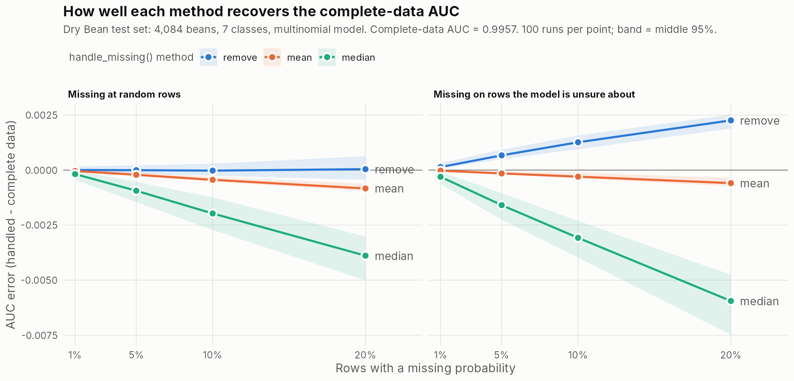

# Dry Bean prototype: `mc_roc()` + `handle_missing()` on real data

**Workflow:** Dry Bean dataset → train a multiclass model → probability
predictions → `mc_roc` object → introduce controlled missing probabilities →
`handle_missing()` → compare remove / mean / median.

Run from the package root:

```r
source("development/drybean/drybean_handle_missing.R")
```

It takes about 2.5 minutes. The script writes three files to `results/`:

| File | Contents |
|---|---|
| `drybean_missing_runs.csv` | every run (2,400 rows) |
| `drybean_missing_summary.csv` | one row per setting x method |
| `drybean_missing_error.png` | the figure below |

## Setup

- **Data:** 13,611 beans with 16 shape features and 7 classes. Class sizes
  range from 522 (BOMBAY) to 3,546 (DERMASON). There are no missing values in
  the original data. Source: Koklu & Ozkan (2020), UCI Machine Learning
  Repository.
- **Model:** multinomial logistic regression (`nnet::multinom`). It was
  trained on a stratified 70% split, with features standardised using the
  training means and SDs.
- **Test set:** 4,084 beans. Accuracy is 92.3%, and the Hand & Till AUC from
  `mc_roc()` is **0.9957** (`DATA CHECKS: VALID`). This is the reference value.
- **Controlled missingness:** in 1%, 5%, 10% or 20% of test rows, one of the
  7 probabilities is set to `NA` (random column). Rows are chosen in one of
  two ways:
  - **random**: every row is equally likely;
  - **uncertain**: rows the model is unsure about are more likely to be hit
    (weight = 1 − largest probability).
- **Per run:** `mc_roc()`, then `handle_missing()` with each method, then
  `mc_refit()`. There are 100 runs per setting: 2 ways of choosing rows x
  4 rates x 100 runs = 800 datasets, each handled 3 ways (2,400 results).
- **Error** = AUC after handling − AUC on the complete data. 0 means the
  method recovered the true value.



## Results (20% of rows affected)

| Rows chosen | Method | Mean error | Middle 95% of runs |
|---|---|---|---|
| random | remove | +0.00004 | −0.00044 to +0.00063 |
| random | mean | −0.00083 | −0.00096 to −0.00062 |
| random | median | −0.00389 | −0.00501 to −0.00302 |
| uncertain | remove | **+0.00226** | +0.00189 to +0.00252 |
| uncertain | mean | −0.00059 | −0.00074 to −0.00036 |
| uncertain | median | **−0.00594** | −0.00748 to −0.00475 |

All rates are in `results/drybean_missing_summary.csv`. The errors grow
roughly in line with the missing rate.

**What this shows**

1. **The workflow works end to end on real data.** In all 800 datasets:
   - `mc_roc()` warned with the count and percentage;
   - `handle_missing()` reported what it removed or filled;
   - `mc_refit()` returned a valid `mc_roc` object.

   In every run, "remove" gave exactly the complete-case AUC that `mc_roc()`
   had already reported.
2. **Remove is unbiased only when values go missing at random.** When they
   go missing on hard beans, removing those rows drops the hard cases and
   **overstates** the AUC. At 20%, 1 − AUC falls from 0.0043 to 0.0020, so
   the model looks about twice as good as it is.
3. **Median imputation is the least accurate here.** For any one class, most
   beans belong to other classes, so the column median is essentially zero
   (0.00002 for BARBUNYA, 0.0004 for SIRA). When a bean's own-class
   probability is missing, the median fills in about zero, and the bean is
   ranked as if it clearly isn't that class. At 20% random, 1 − AUC goes from
   0.0043 to 0.0082.
4. **Mean imputation sits in between.** It slightly underestimates the AUC in
   both settings, but it is the most accurate method when values go missing
   on uncertain beans.

The absolute errors look small because the model is very good (AUC close
to 1). They are large relative to 1 − AUC, which is what separates good
models.

**Suggestions for `handle_missing()` (owner's call)**

- **Document that "remove" assumes values are missing at random.**
- **Don't make median the default for probabilities.**
- **Consider a "complement" fill.** Each row's probabilities sum to 1, so a
  single missing value can be recovered as 1 − (sum of the others). A quick
  check at 20% gave an AUC error of about 0.00004, against about 0.0008 for
  mean.

## Draft statement for the supervisor

> We tested the function on a real seven-class classification dataset
> containing 13,611 observations (Dry Bean, UCI). A multinomial logistic
> regression trained on 70% of the beans reached 92.3% accuracy and a
> Hand & Till AUC of 0.9957 on the 4,084 test beans. We then removed one
> predicted probability from 1–20% of test rows, either at random or
> concentrated on beans the model was unsure about, repeating each setting
> 100 times (800 datasets, 2,400 handled results). In every run
> `handle_missing()` reported the number and percentage of affected rows and
> returned a valid `mc_roc` object. With values missing at random, removing
> rows recovered the complete-data AUC without systematic bias (mean error
> +0.00004 at 20%). Mean imputation slightly underestimated it (−0.0008), and
> median imputation underestimated it most (−0.0039), because each class's
> median probability is close to zero. With values missing on uncertain
> beans, removal overstated the AUC (+0.0023 at 20%, roughly halving the
> apparent 1 − AUC), and mean imputation was the most accurate (−0.0006).
